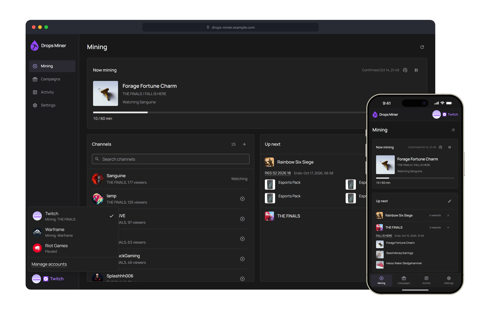

  

<h1 align="center">Twitch Drops Miner</h1>

Mine timed Twitch Drops without streaming video or audio.

  

## Get started

Download the [desktop app](https://github.com/ohne-b/twitch-drops-miner/releases) or follow the
[Docker setup](https://github.com/ohne-b/twitch-drops-miner/wiki/Installation#docker).

See the [wiki](https://github.com/ohne-b/twitch-drops-miner/wiki) for setup, accounts,
Telegram, HTTPS and troubleshooting.

> [!NOTE]
> This is a personal project for use on your own hardware and home network. VPS/cloud
> hosting and services for other users aren't supported. Twitch changes can break compatibility.
> Not affiliated with Twitch in any way.

## Contributing

See [CONTRIBUTING.md](CONTRIBUTING.md) for development, testing and review requirements.
Report bugs through [GitHub issues](https://github.com/ohne-b/twitch-drops-miner/issues)
with your version, installation method and redacted logs. Never share credentials or device codes.

> [!NOTE]
> English only for now, no translations needed.

## License and credits

[PolyForm Noncommercial 1.0.0](https://github.com/ohne-b/twitch-drops-miner?tab=License-1-ov-file), copyright 2026 ohne-b (OhneB).
This is source-available software for noncommercial use, with permission to modify and
redistribute under the license's terms. Keep the license and required notices with copies.
Previously published copies retain their original license terms. Third-party components
retain their own licenses.

Based on [rangermix/TwitchDropsMiner](https://github.com/rangermix/TwitchDropsMiner),
which builds on [DevilXD/TwitchDropsMiner](https://github.com/DevilXD/TwitchDropsMiner),
and their contributors. The full upstream MIT license is preserved in [NOTICE.md](NOTICE.md).
Campaign data comes from the [SunkwiBOT public catalog](https://github.com/SunkwiBOT/twitch-drops-api).
Bundled font and icon notices are in
[frontend/public/assets/licenses](frontend/public/assets/licenses).
